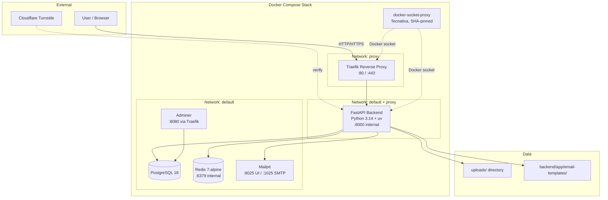
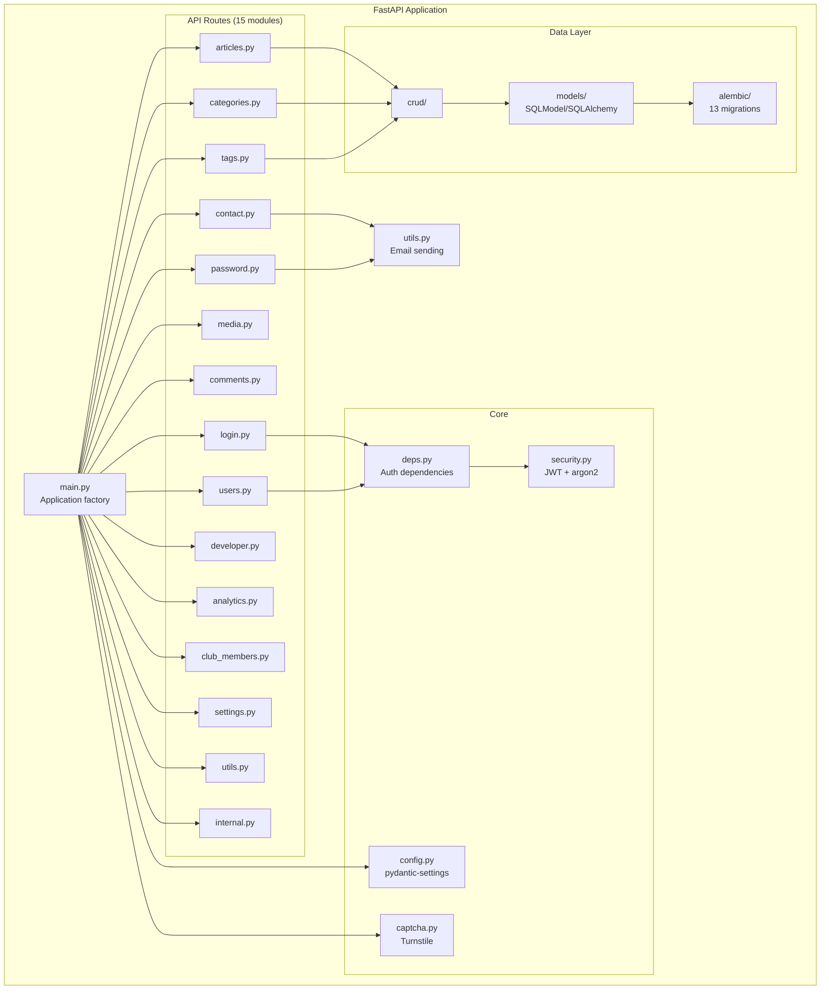
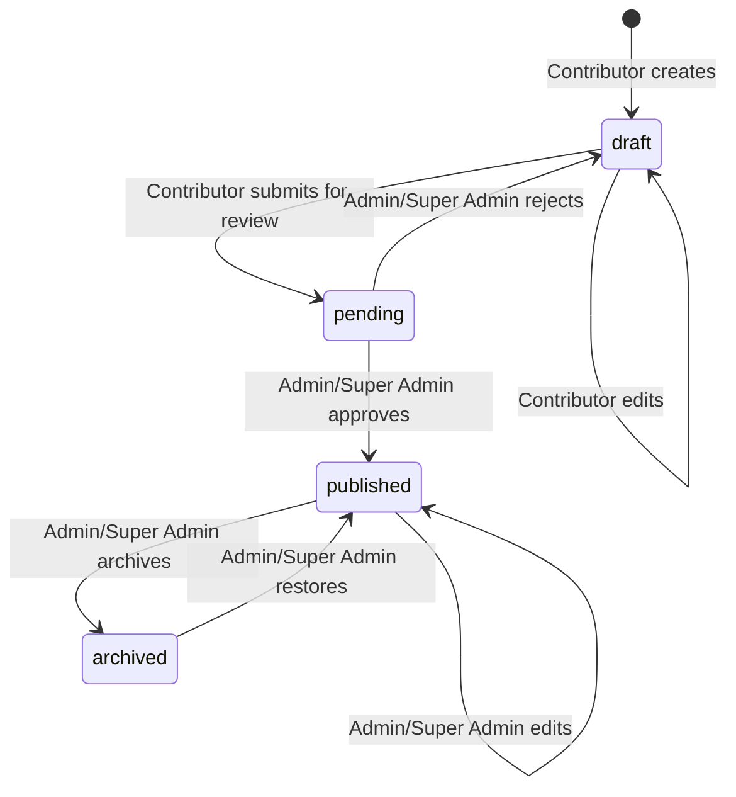
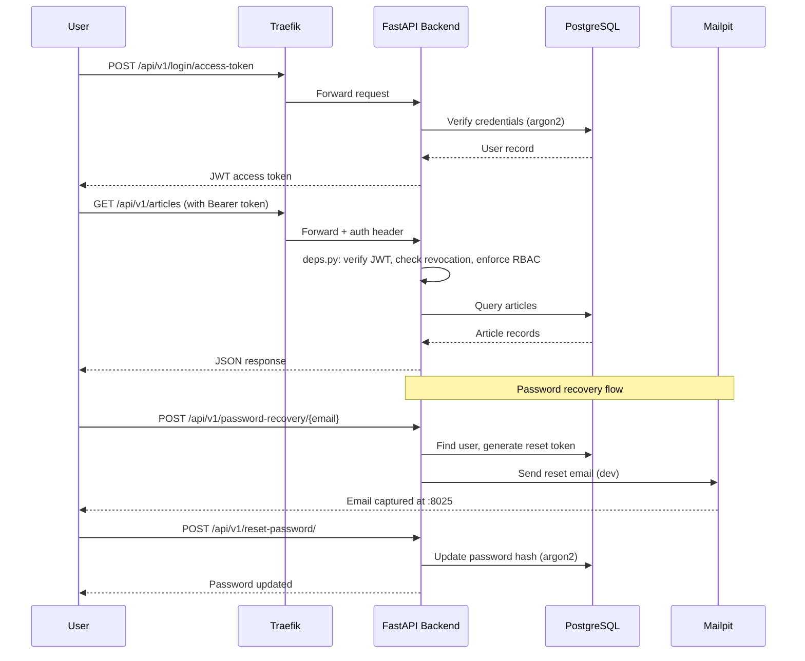
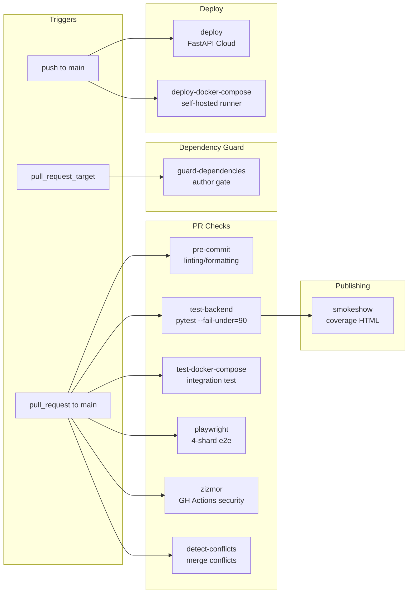
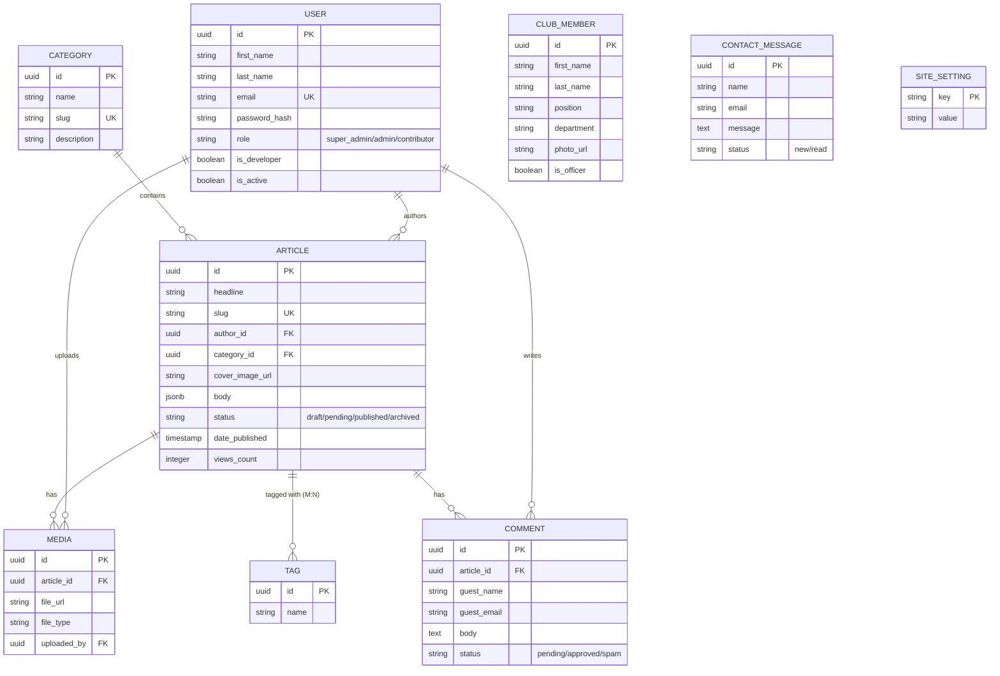
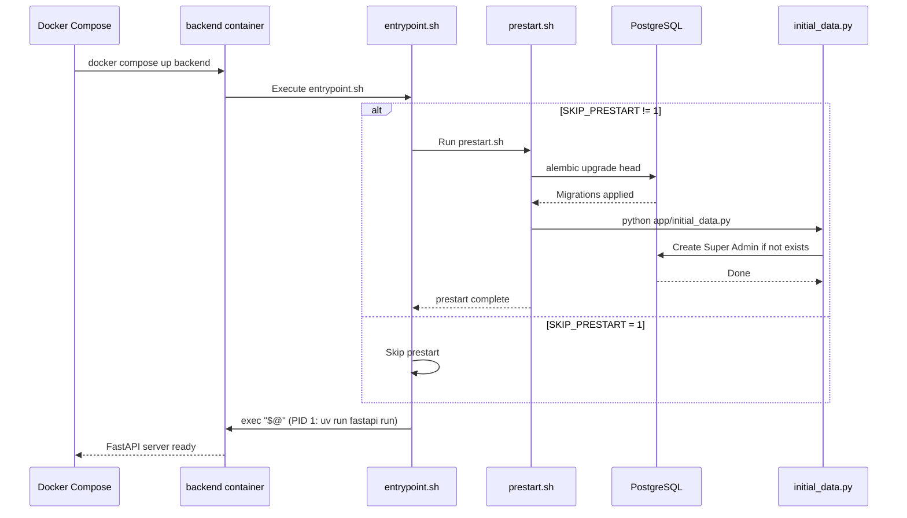
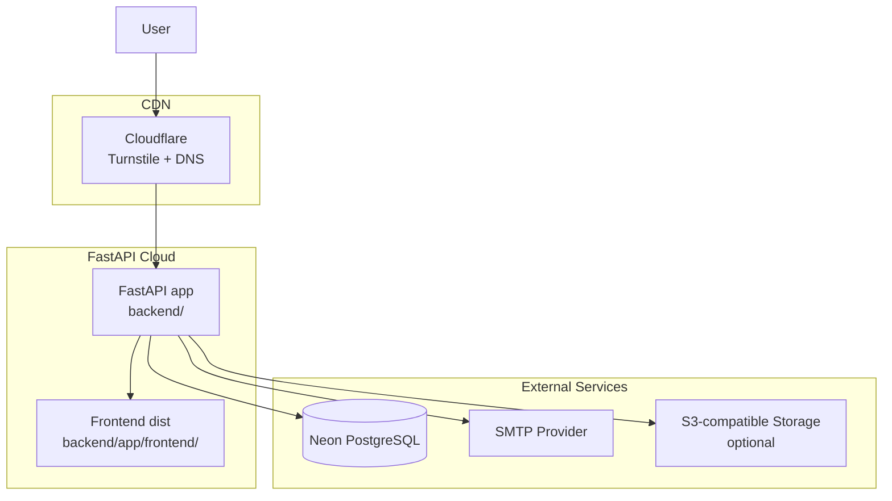
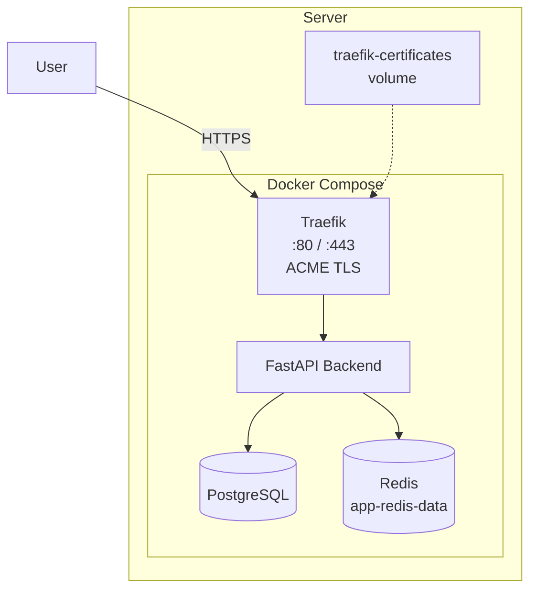

# Eagle Eye — Architecture Diagrams

> Evidence-based Mermaid diagrams of the current system architecture.
> All diagrams reflect **IMPLEMENTATION REALITY** as of commit `792c43c`.

---

## 1. System Overview



---

## 2. Backend Internal Architecture



---

## 3. Article Status Workflow



---

## 4. Authentication & Authorization Flow



---

## 5. CI/CD Pipeline



---

## 6. Frontend Architecture

```mermaid
graph TB
    subgraph "Vite + React + TypeScript"
        ROUTES[routes/<br/>TanStack Router]
        COMPONENTS[components/<br/>shadcn/ui + custom]
        HOOKS[hooks/<br/>custom hooks]
        LIB[lib/<br/>shared utilities]

        subgraph "Generated API Client"
            CLIENT_GEN[client.gen.ts<br/>@hey-api client]
            SDK_GEN[sdk.gen.ts<br/>auto-generated SDK]
            TYPES_GEN[types.gen.ts<br/>auto-generated types]
            LEGACY_CLIENT[client/client/<br/>LEGACY @hey-api dir<br/>still referenced by sdk.gen.ts]
        end
    end

    subgraph "Build Output"
        FRONTEND_DIST[frontend/dist/]
        BACKEND_STATIC[backend/app/frontend/]
    end

    subgraph "E2E Testing"
        PLAYWRIGHT[Playwright<br/>4-shard matrix]
    end

    ROUTES --> SDK_GEN
    COMPONENTS --> HOOKS
    SDK_GEN --> CLIENT_GEN
    SDK_GEN -.->|imports from ./client| LEGACY_CLIENT

    FRONTEND_DIST -->|"bun run build"| BACKEND_STATIC
    PLAYWRIGHT -.->|tests against| ROUTES
```

---

## 7. Email Pipeline

```mermaid
graph LR
    subgraph "Development"
        RE_EMAIL[packages/react-email<br/>workspace: emails]
        TEMPLATES[backend/app/email-templates/<br/>{{ project_name }}, {{ username }}]
        SMTP_BE[backend SMTP utils]
        MP[Mailpit<br/>:1025 SMTP / :8025 UI]
    end

    subgraph "Production"
        SMTP_BE2[backend SMTP utils]
        SMTP_SERVER[SMTP Server<br/>configured via env]
    end

    RE_EMAIL -->|"bun run export"| TEMPLATES
    TEMPLATES --> SMTP_BE
    SMTP_BE -->|"localhost:1025"| MP
    SMTP_BE2 --> SMTP_SERVER
```

---

## 8. Data Model (Simplified ERD)



---

## 9. Container Startup Sequence



---

## 10. Deployment Architecture (FastAPI Cloud)



---

## 11. Deployment Architecture (Self-Hosted Docker Compose)


